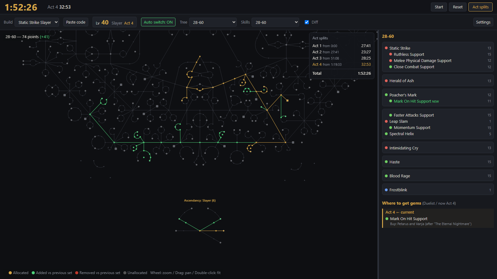

# PoB Leveling Companion

[日本語](#日本語) | [English](#english)

> **非公式ツールです / Unofficial tool.**
> 本ツールは Grinding Gear Games および Path of Building Community とは一切関係のない非公式のファンメイドツールです。
> This is an unofficial fan-made tool and is not affiliated with or endorsed by Grinding Gear Games or Path of Building Community.

---

## 日本語

Path of Exile のレベリング中に、Path of Building (PoB) のビルドの **パッシブツリーとスキルジェムを1画面で** 確認するためのツールです。
ゲームのログ (`Client.txt`) を読み取り、**レベルアップに合わせて Tree / Skill のセットを自動で切り替え** ます。

例: Static Strike Slayer のビルドを Lv40 / Act 4 で表示

### 主な機能
- パッシブツリーとスキルジェムを並べて表示 (アセンダンシー / ブラッドラインはツリーの下に表示)
- レベルアップでセットを自動切替 (セット名の `1-11`、`Level 12-31`、`12 to 33`、`Lvl 90`、`68+` などを解釈)
- 前のセットとの差分表示 (追加=緑 / 削除=赤)
- 現在の Act で入手できるジェム (クエスト報酬 / 購入) を、ゲーム内キャラクターのクラスに合わせて表示 (◀ ▶ で前後の Act、「すべて」で全 Act も表示可能。ゲーム内で Act が変わると現在の Act の表示に戻ります)
- PoB でビルドを保存すると自動で反映、PoB エクスポートコードの貼り付けにも対応
- Act ごとのタイムを計るレベリングタイマー (ゲームを閉じていた時間は除外)
- ゲームの手前に表示し続ける「最前面」表示
- 日本語 / English 表示切替
- ジェム名を英語 / 日本語で表示 (設定で切替。日本語名にマウスを乗せると英語名を表示)
- 新しいバージョンの通知と、ボタン一つでの更新 (設定で無効にできます)

### 必要なもの
- Windows 10 / 11
- [Path of Building Community](https://github.com/PathOfBuildingCommunity/PathOfBuilding) (ツリーデータ・ジェムデータをインストール先から読み込みます)
- Path of Exile (Steam / スタンドアロン / Epic。`Client.txt` は自動検出します)

### 対応範囲
- **Path of Exile 1 のみ対応**です。Path of Exile 2 には対応していません。
- ゲームクライアントの言語は **英語版・日本語版で動作確認済み**です。その他の言語でもレベルアップを検出できるようにしていますが、動作は未確認です。

### 入手方法
[Releases](https://github.com/0z0zh/pob-leveling-companion/releases) から最新の `PoBLevelingCompanion.exe` をダウンロードし、任意のフォルダに置いて実行します。インストールや Python は不要です。

### 使い方

1. 「ビルド」から PoB の保存済みビルドを選びます (または「コード貼付」でエクスポートコードを読み込み)。
2. ゲームでレベルが上がると、そのレベルに合うセットへ自動で切り替わります。
3. セットを手動で選ぶと自動切替は OFF になります。ボタンで ON に戻せます。

### 更新
起動時に GitHub で新しいバージョンを確認し、あれば画面上部に「新しいバージョン vX.Y.Z があります」と表示します。
「更新」を押すと、新しい exe をダウンロードして SHA-256 チェックサムで検証し、アプリを一度閉じて入れ替え、自動で起動し直します。
「詳細」でリリースのページを開けます。確認は「設定」で無効にできます。

### セットの選び方
- セット名から数値範囲を読み取り、「下限が現在のレベル以下のうち最も大きいもの」を選びます (例: Lv12 で `1-12` と `12-31` があれば `12-31`)。
- 数字のないセット (例: `Maps`) が `34 - 52` のような範囲の直後にある場合は、次のレベル (53) から使うものとみなします。
- `{3}` のような番号はレベルとして扱いません。`Earlygame` のように数字のないセットは自動切替の対象外です。

### タイマー
画面の一番上にレベリングのタイマーがあります。大きな数字が合計タイム、その右が今いる Act のタイムです。
「Act 別タイム」で Act ごとのタイムの一覧を表示/非表示できます。
タイムはゲームのログ (`Client.txt`) の時刻から計算するため、アプリを途中で起動・再起動しても正しく続きます。

**スタート**
- 既定は手動です。フィルター設定などの準備が終わったら「スタート」を押してください。押した瞬間から計測し、そのときにいる Act から区切りを記録します。
- 「設定」で自動スタートを ON にすると、新しいキャラクターで黄昏の岸辺に入場した時点 (読み込みが終わり「入場しました」と出た瞬間) から自動で計測します。
  (Lv2 になった時点で新キャラと判定し、直前の入場時刻をスタートにします。Act 1 の途中で岸辺に戻ってもリセットされません)

**Act の区切り**
- 次の Act のエリアに初めて入った時点で区切ります。Act は1つずつ進むものとして扱い、Act 4 から急にエンドゲームへ移動するような場合は (別のキャラで遊んだとみなして) 区切りにしません。

**計測が続く (止まらない) 場合**
- ゲームが起動している間はずっと計測します。町・隠れ家・キャラクター選択画面にいる時間や、放置している時間も含まれます。
- 計測中に別のキャラクターで遊んだ時間も、ゲームが起動していれば含まれます (ログにはどのキャラがエリアにいるかが出ないため)。
- アプリを閉じていても、ゲームが起動していれば計測は続いています (次にアプリを開いたときにログから計算されます)。

**止まる場合**
| 条件 | 動き |
|---|---|
| エピローグ (Act 10 クリア後のエリア) に入った | 計測終了 (完走)。合計タイムが確定し緑色で表示 |
| ゲームが起動していない | 一時停止。閉じていた時間は合計に含めず、再起動後に続きから計測 |
| 「リセット」を押した | 計測を取り消して未計測に戻る |

- 計測中に「スタート」を押すと、確認のうえ今から計測し直します。
- 記録されるのは1回分だけです。過去のタイムは保存されません。
- 起動時は `Client.txt` の末尾 8MB だけを読みます。非常に長期間にわたる計測で、スタート時点がそれより前になった場合は正しく復元できないことがあります。

### 設定
「設定」から変更でき、exe と同じフォルダの `config.json` に保存されます。
- `Client.txt` のパス (空欄なら自動検出)
- キャラクター名 (空欄ならどのキャラのレベルアップにも反応)
- PoB の Builds フォルダ / インストールフォルダ
- タイマーの自動スタート (既定は OFF)
- ジェム名の言語 (英語 / 日本語。既定は英語)
- 起動時に新しいバージョンを確認する (既定は ON)
- 表示言語

### 注意
- 最前面表示を使う場合、ゲームは「ウィンドウ」または「ボーダーレスフルスクリーン」にしてください。
- 本ツールは `Client.txt` を読むだけで、ゲームのメモリやファイルを変更しません。
- exe は署名されていないため、SmartScreen や Windows Defender に警告されることがあります。

### プライバシー
- 本ツールの通信は **GitHub での新しいバージョンの確認と、更新時のダウンロードだけ**です。確認で送るのはアプリのバージョンを含む api.github.com へのリクエスト1回だけで、キャラクター名やビルドなどのデータは送りません。「設定」で確認を無効にすると、一切通信しません。
- 読み込むのはローカルのファイル (`Client.txt`、PoB のビルド・データ) だけです。
- 画面は PC 内だけで動くローカルサーバー (`127.0.0.1`) から表示しており、外部からはアクセスできません。

### トラブルシューティング
| 症状 | 確認すること |
|---|---|
| レベルや Act が表示されない | 「設定」で `Client.txt` のパスが正しいか確認してください。空欄にすると自動検出をやり直します。 |
| セットが自動で切り替わらない | 「自動切替」が ON か、セット名にレベルの数字 (`1-11`、`Lvl 90` など) が入っているか確認してください。 |
| 別のキャラのレベルに反応してしまう | 「設定」のキャラクター名に、対象のキャラ名を入れてください。 |
| 新しいリーグのツリーが表示されない | ツリーデータは PoB から読み込むため、PoB 本体を最新版に更新してください。 |
| ツリーやジェムが表示されない | 「設定」で PoB のインストールフォルダ・Builds フォルダが正しいか確認してください。 |
| 最前面にしてもゲームの裏に隠れる | ゲームを「ウィンドウ」または「ボーダーレスフルスクリーン」にしてください。 |

### アンインストール
exe と、同じフォルダに作られる `config.json` と `cache\` を削除するだけです。レジストリなどは使用していません。

### 不具合報告・コントリビュート
- 不具合や要望は [Issues](https://github.com/0z0zh/pob-leveling-companion/issues) へお願いします。次の情報があると調査がスムーズです。
  - 症状と再現手順
  - ゲームクライアントの言語 (英語 / 日本語など)
  - 関係する `Client.txt` の行 (キャラクター名は伏せてもかまいません)
  - 使用した PoB のビルド (エクスポートコード)
- Pull Request も歓迎します。大きな変更の場合は、先に Issue で相談してください。
- 更新履歴は [CHANGELOG.md](CHANGELOG.md) を参照してください。

### 開発
- exe のビルド: `build_exe.bat` (`.venv` に pywebview と PyInstaller をインストールし、`dist\PoBLevelingCompanion.exe` を作成。ビルドの作業ファイルは `build\` に作られます)
- 自動ビルド: GitHub Actions (`.github/workflows/build.yml`) が `main` への push と Pull Request ごとに exe をビルドします。`v0.1.1` のようなタグを push すると、同じ名前のリリースに exe と SHA-256 チェックサム (`.sha256`) を自動で添付します。ビルドに使うライブラリのバージョンは `requirements-build.txt` で固定しています。
- リリース手順: `VERSION` と CHANGELOG を更新してコミット → `git tag v0.1.1` → `git push origin main v0.1.1` (タグと `VERSION` が一致しないとリリースは作られません。exe の製品名とバージョン情報は `VERSION` から埋め込まれます)
- exe にせずに動かす: `.venv\Scripts\python app.py` (この場合、`config.json` と `cache\` はプロジェクトフォルダに作られます)
- ジェム入手データの更新: `python tools/update_gem_data.py`
- 日本語ジェム名の更新: `python tools/update_gem_names_ja.py` (公式トレードサイトの英語・日本語のジェム一覧を1回ずつ取得して `data/gem_names_ja.json` を作成。アプリはこのデータを取りに行きません)
- 構成:
  - `app.py`: 起動処理。ウィンドウを開き、`server.py` のサーバーを起動
  - `server.py`: ログ監視・タイマー・PoB データ解析・画面向け API
  - `static/index.html`: 画面
  - `data/gem_sources.json`: ジェム入手データ (`tools/update_gem_data.py` で生成)

---

## English

A companion tool for leveling in Path of Exile that shows a Path of Building (PoB) build's **passive tree and skill gems on one screen**.
It reads the game log (`Client.txt`) and **switches the tree / skill set automatically when you level up**.

Example: a Static Strike Slayer build at Lv 40 / Act 4

### Features
- Passive tree and skill gems side by side (ascendancy / bloodline drawn below the tree)
- Automatic set switching on level-up (understands set names like `1-11`, `Level 12-31`, `12 to 33`, `Lvl 90`, `68+`)
- Diff against the previous set (added = green / removed = red)
- Gems you can get in your current act (quest rewards / vendors), based on your in-game character's class (◀ ▶ browse other acts and "All" shows every act; the list goes back to your current act when you enter a new act in game)
- Picks up changes when you save the build in PoB; PoB export codes can also be pasted
- Leveling timer with per-act splits (time while the game is closed is excluded)
- "Always on top" to keep the window above the game
- Japanese / English UI
- Gem names in English or Japanese (switch in Settings; hover a Japanese name to see the English one)
- New-version notice and one-click update (can be turned off in Settings)

### Requirements
- Windows 10 / 11
- [Path of Building Community](https://github.com/PathOfBuildingCommunity/PathOfBuilding) (tree and gem data are read from its install folder)
- Path of Exile (Steam / standalone / Epic; `Client.txt` is detected automatically)

### Supported
- **Path of Exile 1 only.** Path of Exile 2 is not supported.
- Tested with the **English and Japanese** game clients. Level-ups should also be detected in other client languages, but this is untested.

### Download
Download the latest `PoBLevelingCompanion.exe` from [Releases](https://github.com/0z0zh/pob-leveling-companion/releases), put it in any folder and run it. No installation or Python is needed.

### Usage

1. Pick a saved PoB build from "Build" (or load an export code with "Paste code").
2. When you level up in game, the matching set is selected automatically.
3. Choosing a set by hand turns auto switching off; click the button to turn it back on.

### Updating
At start-up the app checks GitHub for a newer release and, if there is one, shows "Version vX.Y.Z is available" at the top.
"Update" downloads the new exe, verifies it against the release's SHA-256 checksum, closes the app, swaps the exe and starts it again.
"Details" opens the release page. The check can be turned off in Settings.

### How sets are chosen
- A level range is read from each set name, and the set whose lower bound is the highest one not above your level is used (e.g. at Lv 12 with `1-12` and `12-31`, `12-31` wins).
- A set without a number (e.g. `Maps`) right after a closed range such as `34 - 52` is treated as starting at the next level (53).
- Tags like `{3}` are ignored. Sets without any level number (e.g. `Earlygame`) are never chosen automatically.

### Timer
The bar at the top of the window is a leveling timer: the large number is the total time and the one next to it is the time in your current act.
"Act splits" shows or hides the per-act times.
Times are calculated from the timestamps in the game log (`Client.txt`), so opening or restarting the app mid-run does not break the run.

**Starting**
- Manual by default: press "Start" when you are ready (e.g. after setting up your loot filter). Timing starts at that moment, from the act you are in.
- With automatic start enabled in "Settings", the timer starts when a new character enters The Twilight Strand (the moment the area has loaded and "You have entered" is logged).
  (A character is treated as new when it reaches Lv 2; the strand entry just before that becomes the start. Going back to the strand during Act 1 does not reset it.)

**Act splits**
- A split is taken the first time you enter an area of the next act. Acts are assumed to be played in order, so a jump such as Act 4 → endgame town (playing another character) is not counted as a split.

**When the timer keeps running**
- It runs the whole time the game is running, including time in towns, hideouts, character select, or while idle.
- Time spent playing a different character during a run is also counted while the game is open (the log does not say which character is in an area).
- It keeps running even while the app is closed, as long as the game is running (the time is recalculated from the log when the app opens).

**When the timer stops**
| Condition | What happens |
|---|---|
| You enter the epilogue (the area after finishing Act 10) | The run is finished; the total is fixed and shown in green |
| The game is not running | Paused. Time while the game is closed is not counted; timing continues when the game starts again |
| You press "Reset" | The run is discarded and the timer goes back to idle |

- Pressing "Start" during a run asks for confirmation and starts again from now.
- Only one run is kept; past times are not saved.
- On start-up only the last 8 MB of `Client.txt` is read. For a run spread over a very long period, a start time older than that may not be restored correctly.

### Settings
Change them in "Settings"; they are saved to `config.json` next to the exe.
- Path to `Client.txt` (leave empty to auto-detect)
- Character name (empty = react to any character's level-up)
- PoB Builds folder / install folder
- Start the timer automatically (off by default)
- Gem name language (English / Japanese; English by default)
- Check for a new version at start-up (on by default)
- Language

### Notes
- For "always on top", run the game in windowed or borderless fullscreen mode.
- The tool only reads `Client.txt`; it never touches game memory or game files.
- The exe is unsigned, so SmartScreen or Windows Defender may warn about it.

### Privacy
- The only network access is **checking GitHub for a newer release and downloading it when you update**. The check is a single request to api.github.com containing only the app version; no character names, builds or other data are sent. With the check turned off in Settings, the tool never connects to the internet.
- It only reads local files (`Client.txt`, your PoB builds and PoB data).
- The UI is served by a local server on `127.0.0.1` that cannot be reached from other machines.

### Troubleshooting
| Problem | What to check |
|---|---|
| Level / act is not shown | Check the path to `Client.txt` in "Settings". Clear it to run auto-detection again. |
| Sets do not switch automatically | Make sure "Auto switch" is ON and that your set names contain a level (`1-11`, `Lvl 90`, ...). |
| It reacts to another character's level-ups | Enter your character's name in "Settings". |
| The tree for a new league is missing | Tree data comes from PoB, so update Path of Building to the latest version. |
| The tree or gems are not shown | Check the PoB install folder and Builds folder in "Settings". |
| "On top" still hides behind the game | Run the game in windowed or borderless fullscreen mode. |

### Uninstall
Delete the exe and the `config.json` and `cache\` created next to it. Nothing is written to the registry.

### Reporting issues / contributing
- Please report bugs and requests in [Issues](https://github.com/0z0zh/pob-leveling-companion/issues). These help a lot:
  - what happened and how to reproduce it
  - your game client language (English, Japanese, ...)
  - the related lines from `Client.txt` (feel free to hide your character name)
  - the PoB build you used (export code)
- Pull requests are welcome. For larger changes, please open an issue first.
- See [CHANGELOG.md](CHANGELOG.md) for the release history.

### Development
- Build the exe: `build_exe.bat` (installs pywebview and PyInstaller into `.venv` and creates `dist\PoBLevelingCompanion.exe`; intermediate build files go to `build\`)
- Automatic builds: GitHub Actions (`.github/workflows/build.yml`) builds the exe for every push to `main` and every pull request. Pushing a tag such as `v0.1.1` also attaches the exe and its SHA-256 checksum (`.sha256`) to the release of that tag. Build dependency versions are pinned in `requirements-build.txt`.
- Releasing: update `VERSION` and CHANGELOG and commit → `git tag v0.1.1` → `git push origin main v0.1.1` (the release is refused if the tag does not match `VERSION`; the exe's product name and version metadata come from `VERSION`)
- Run without building: `.venv\Scripts\python app.py` (`config.json` and `cache\` are then created in the project folder)
- Refresh gem acquisition data: `python tools/update_gem_data.py`
- Refresh Japanese gem names: `python tools/update_gem_names_ja.py` (fetches the English and Japanese gem lists of the official trade site once each and writes `data/gem_names_ja.json`; the app never fetches this data itself)
- Layout:
  - `app.py`: entry point; opens the window and starts the server in `server.py`
  - `server.py`: log watcher, timer, PoB data parsing and the API used by the UI
  - `static/index.html`: UI
  - `data/gem_sources.json`: gem acquisition data (generated by `tools/update_gem_data.py`)

---

## Code signing policy

Free code signing provided by [SignPath.io](https://about.signpath.io/), certificate by [SignPath Foundation](https://signpath.org/).

> Status: code signing through the SignPath Foundation is planned and has not been applied for yet. Until it is enabled, release executables are unsigned.

- Release executables are built from this repository by [GitHub Actions](.github/workflows/build.yml) on GitHub-hosted runners; nothing built on a personal machine is signed.
- Every signing request is approved manually by an approver.
- Team roles:
  - Committers and reviewers: [0z0zh](https://github.com/0z0zh)
  - Approvers: [0z0zh](https://github.com/0z0zh)
- Privacy policy: Apart from checking GitHub for a newer release (which can be turned off in Settings), this program will not transfer any information to other networked systems unless specifically requested by the user or the person installing or operating it. The update check sends a single request to api.github.com containing only the app version; updating downloads the new release from github.com.

コード署名ポリシー (日本語): 上記のとおり、署名は SignPath.io が無償で提供し、証明書は SignPath Foundation が発行します (申請はこれからで、有効になるまでリリースの exe は署名なしです)。署名する exe は本リポジトリから GitHub Actions でビルドしたものだけで、署名のたびに承認者が手動で承認します。GitHub での新しいバージョンの確認 (設定で無効にできます) を除き、本プログラムは利用者が明示的に求めない限り、ネットワーク上の他のシステムに情報を送信しません。更新の確認で送るのは、アプリのバージョンを含む api.github.com へのリクエスト1回だけです。更新すると github.com から新しいリリースをダウンロードします。

## License

[MIT License](LICENSE)

### Credits
- Gem acquisition data (`data/gem_sources.json`) is derived from [exile-leveling](https://github.com/HeartofPhos/exile-leveling) — Copyright (c) 2025 HeartofPhos, MIT License.
- Passive tree and gem data are read at runtime from your local [Path of Building Community](https://github.com/PathOfBuildingCommunity/PathOfBuilding) installation (MIT License) and are not redistributed.
- See [THIRD_PARTY_NOTICES.md](THIRD_PARTY_NOTICES.md) for full license texts.

- Japanese gem names (`data/gem_names_ja.json`) are generated from the gem lists of Grinding Gear Games' official trade site (www.pathofexile.com / jp.pathofexile.com). They are Grinding Gear Games' content; this project has not been reviewed, endorsed or approved by Grinding Gear Games.

Path of Exile is a trademark of Grinding Gear Games. Path of Exile, in-game names, items and related game data belong to Grinding Gear Games.
